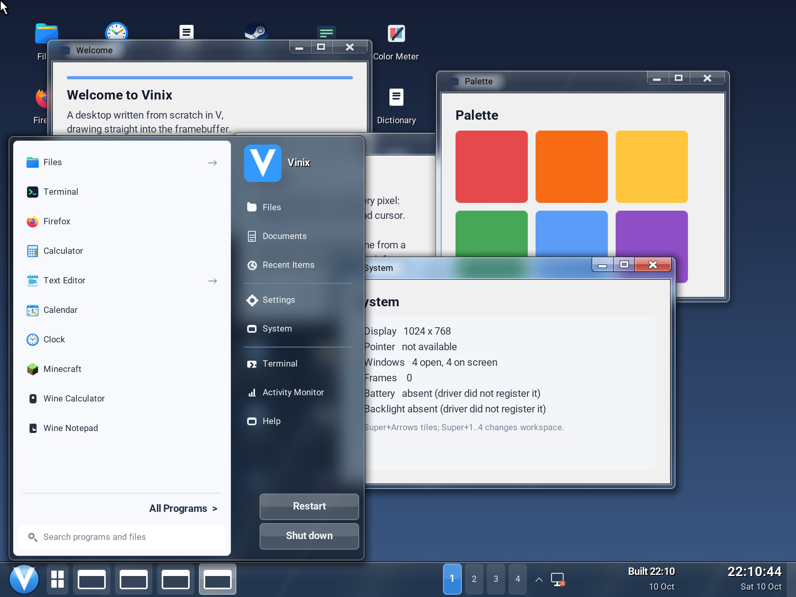
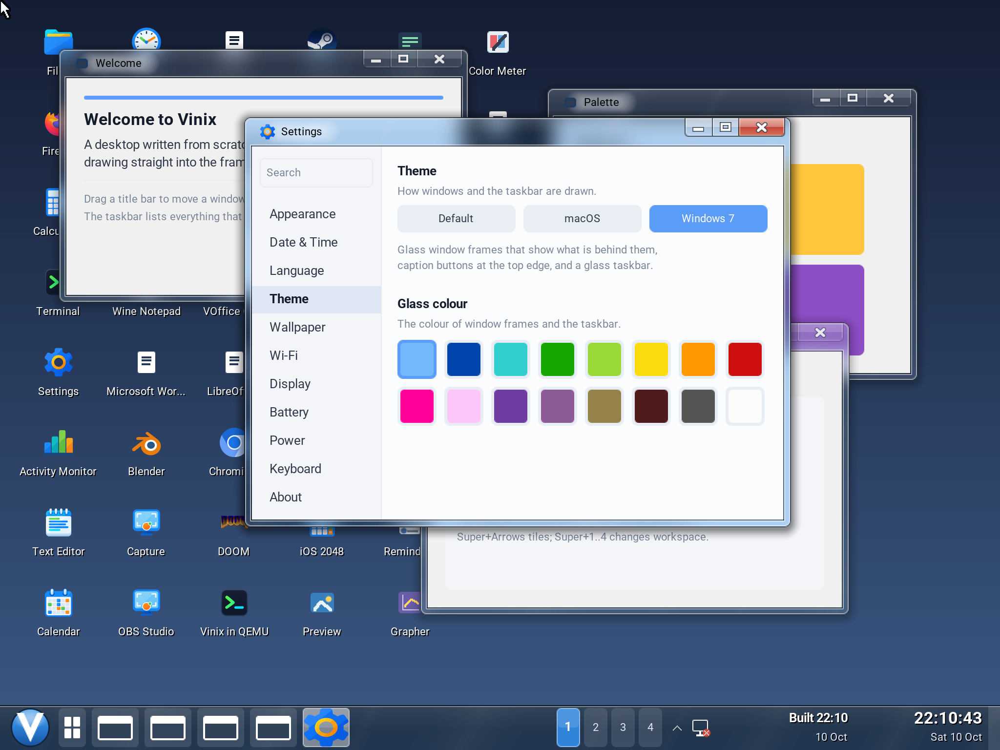
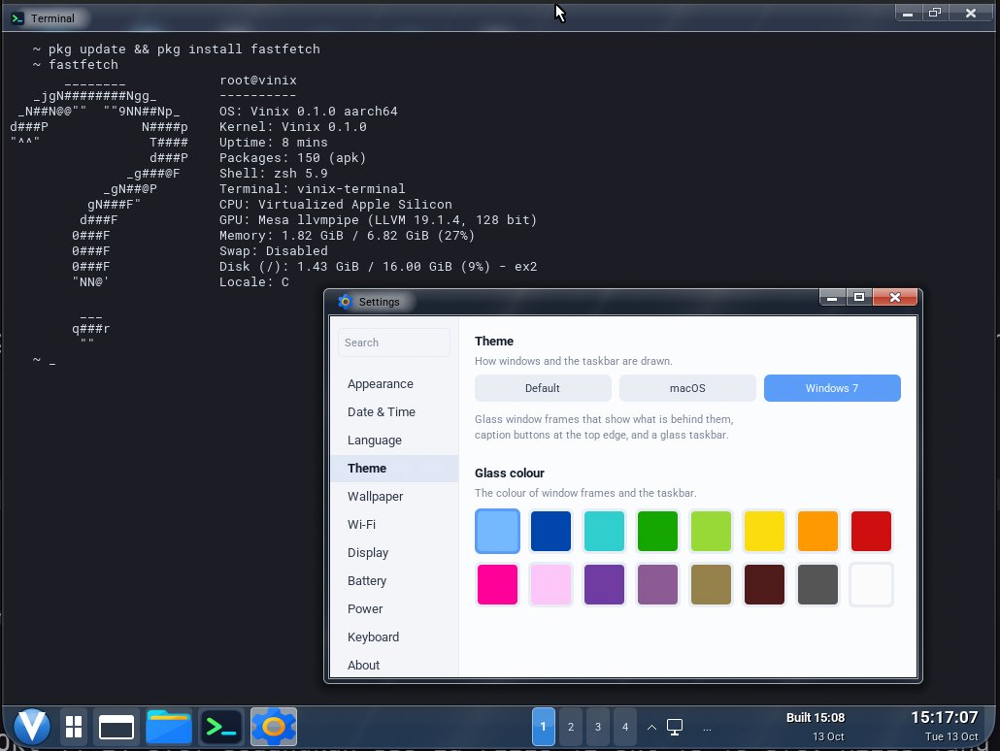

Vinix now has a Windows 7 Aero theme. Glass window borders blur and tint what is
behind them, the taskbar carries the same finish, and the Start menu opens with
a familiar two-column layout beneath a round V button.

The screenshot shows the new theme on the Vinix desktop, with Welcome, Palette
and System windows behind the Start menu. The coloured blocks in Palette show
through the System window's title bar as soft patches of colour. That is the
glass effect at work: the frame picks up the actual scene beneath it.

## The details that make Aero feel like Aero

The window frame has rounded outer corners, a narrow glass border around the
application, and a larger glass strip above it. A small application icon sits
beside a black title with a white glow, keeping the text readable as the
background changes.

Minimize, maximize and close form one group attached to the top edge. The close
button is wider and turns red on the focused window. Fine dark and light lines
outline the frame, and diagonal bands of reflected light run across the glass.
Unfocused windows use a weaker tint and softer highlights. Maximizing a window
keeps the glass along its top.

The theme is drawn by the desktop compositor, which gives the open applications
the same frame and controls. It also paints the glass taskbar and the Start
menu's outer shell. The menu combines a light program list and search field on
the left with links to Files, Settings, System and other destinations on the
right. Restart and Shut down sit at the bottom.

The Start button keeps Vinix's identity: a white V inside a blue orb.

## Pick your glass colour

Open **Settings → Theme → Windows 7** to switch to Aero. The Theme pane also
offers **Default** and **macOS**, so switching between the desktop's looks is
one click.

With Windows 7 selected, **Glass colour** offers sixteen presets in two rows:
Sky, Twilight, Sea, Leaf, Lime, Sun, Pumpkin, Ruby, Fuchsia, Blush, Violet,
Lavender, Taupe, Chocolate, Slate and Frost. These follow Windows 7's Window
Color palette. Sky, the light blue in the screenshot, is the initial choice.

A colour choice applies to the window frames, taskbar and Start menu. Each
preset has its own tint strength, so choosing a colour changes how much of the
backdrop comes through as well as the hue. Theme and glass colour changes take
effect immediately and are saved with the desktop's other preferences. They
are restored on the next launch when the desktop's home volume is persistent.

Here is the theme with Settings open over Terminal running fastfetch. The glass
frames and taskbar carry the selected Sky colour across the desktop.

## Drawing glass in V

The Aero renderer lives in
[`desktop/glass.v`](https://github.com/vlang/vinix/blob/master/desktop/glass.v).
It is written in V and works with the desktop's software canvas, which is
painted into the framebuffer.

The compositor draws the scene from back to front. When it reaches a glass
surface, the canvas already contains the picture behind that surface. The
renderer averages those pixels into cells four logical pixels across and runs
three box-blur passes over them to approximate a Gaussian blur. It then blends
the blurred backdrop with the selected colour and an afterglow whose strength
follows the backdrop's brightness. Reflection bands, highlights and frame
edges finish the result.

Keeping that backdrop between frames matters. Vinix often redraws only the
part of the screen that changed. Sampling the rest of the canvas again would
pick up glass that was already drawn there, feeding the effect back into
itself. Instead, each glass surface keeps its own backdrop, and a partial
redraw refreshes only the cells fully inside the repainted area. Changes that
spread through the blur beyond that area schedule a further redraw.

That lets a clock tick or an application update pass through nearby glass
without rebuilding the whole desktop for every change.

The [desktop guide](https://github.com/vlang/vinix/blob/master/desktop/README.md)
has the build and launch instructions. Once the current desktop is running,
choose Windows 7 in Settings, open a few overlapping windows, and try a
different glass colour.
